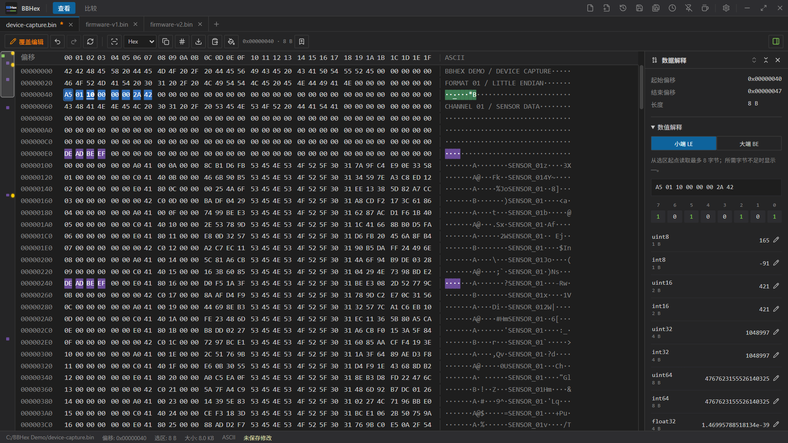
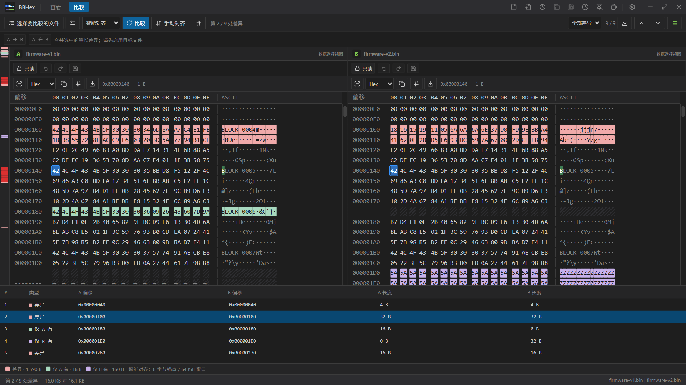
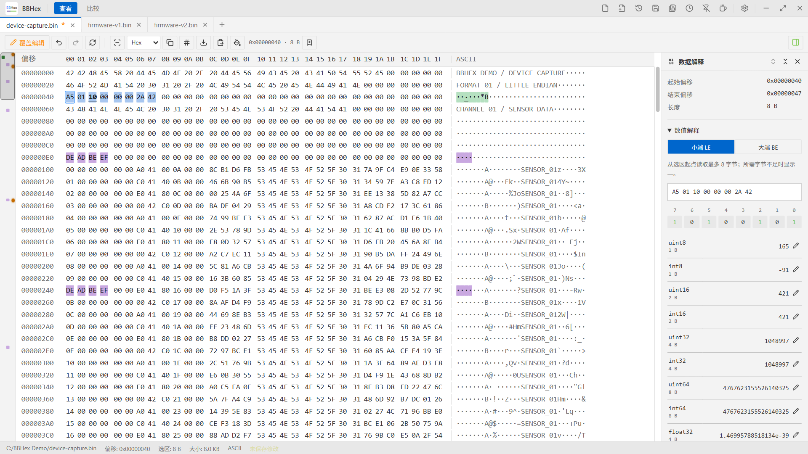
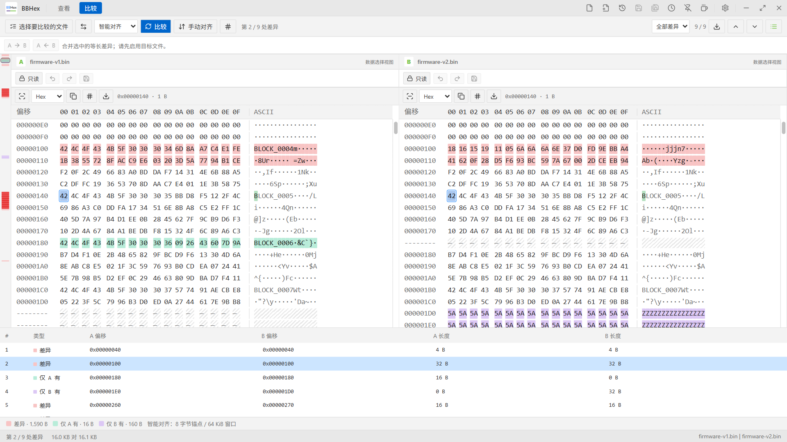
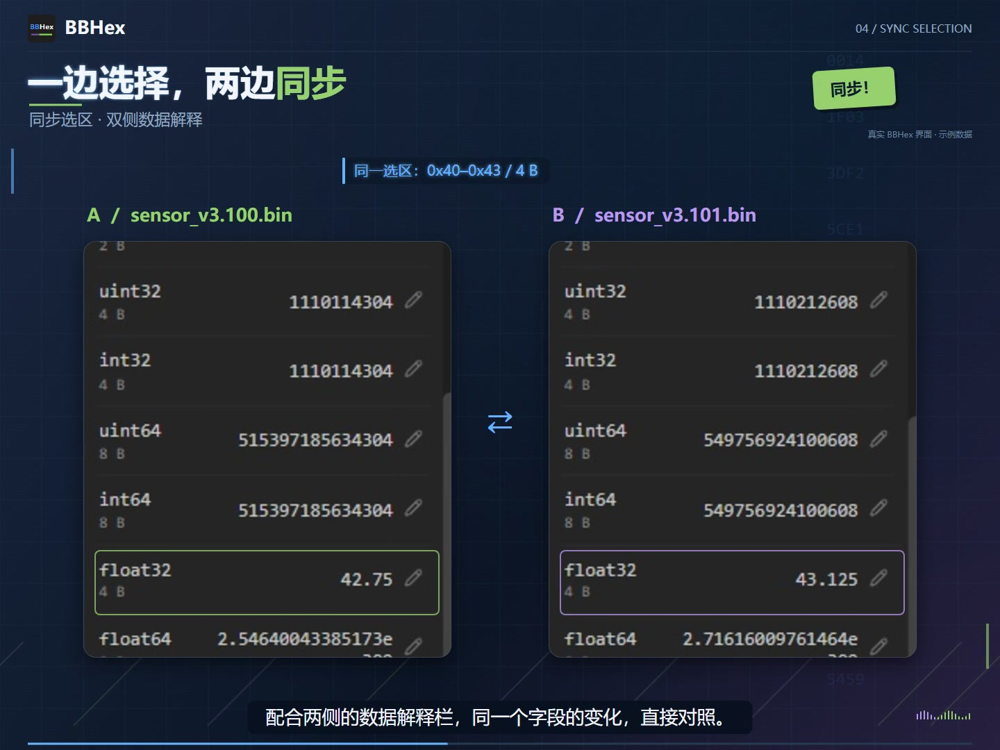
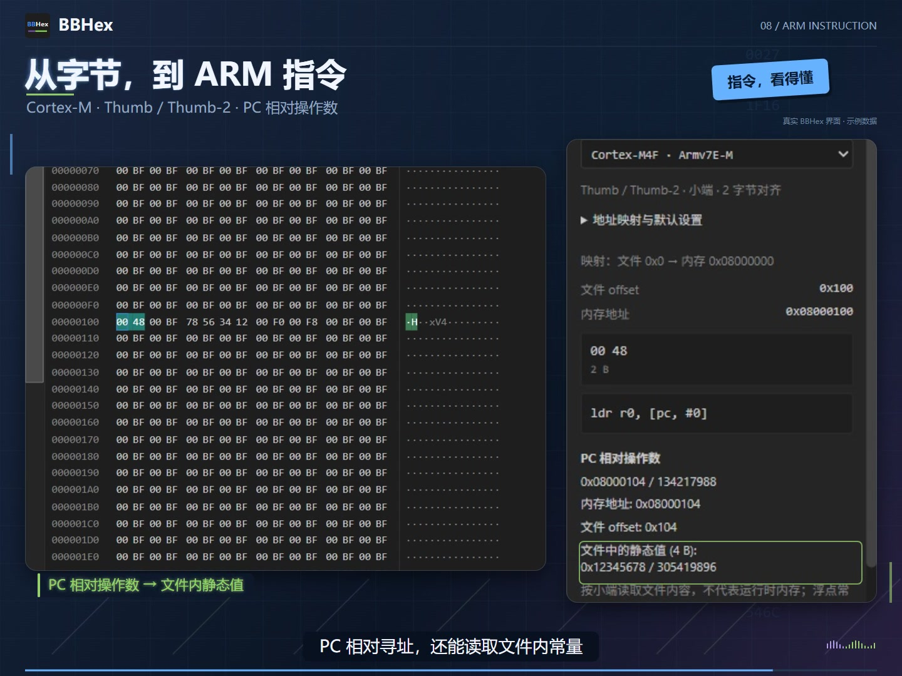

  <picture>
    <source media="(prefers-color-scheme: dark)" srcset="assets/brand/logo-dark.svg">
    <source media="(prefers-color-scheme: light)" srcset="assets/brand/logo-light.svg">
    
  </picture>

<h1 align="center">BBHex</h1>

<strong>看得清，改得准，比得快。</strong>

BBCom Team 出品的 Windows 二进制文件查看、编辑与比较工具。

  <a href="readme.md">English</a> · 简体中文 
  <a href="https://github.com/BBComTeam/BBHex/releases">版本与下载</a> ·
  <a href="https://www.bbcom.online/">官方网站</a> ·
  <a href="https://github.com/BBComTeam/BBHex/issues">问题反馈</a>

BBHex 将 HEX／ASCII 查看、精确字节编辑与双文件比较整合到同一个桌面工作区。检查固件镜像、分析设备导出的数据、核对二进制版本变化，都可以在延续 [BBCom](https://github.com/BBComTeam/BBCom) 风格的界面中完成。

> **仓库说明：** 这里用于公开 BBHex 的使用文档、界面图片、问题反馈和 Release 安装包，暂不公开应用源码。仓库公开不代表 BBHex 应用已经开源。

## 核心功能

### 文件查看与定位

- **HEX 与 ASCII 联动显示**，支持多文件标签、字节分组和字号调整。
- **文件总览栏**显示当前可视范围、搜索命中分布、已修改字节和书签亮点；点击跳转时保留原选区。
- **精确地址导航**、范围选择、上下翻页，以及拖动总览栏或滚动条时的地址提示。
- **HEX／ASCII 搜索**，支持整字节 `??` 通配符及选区内搜索；默认搜索方式跟随此前选中的 HEX／ASCII 区域。

### 文件比较

- **双文件并排比较**，用不同颜色区分内容差异、仅 A 存在和仅 B 存在的数据。
- **严格比较、智能对齐与手动对齐**，通过对齐空隙显示插入或缺失的数据。
- **差异列表、类型筛选与前后导航**，支持导出 CSV 差异报告。
- **Sync Selection 同步选区**：在任意一侧选择数据，另一侧同步选择对应范围。
- A／B 文件各有**独立数据解释栏**，可按需收起。
- 比较模式也支持搜索、地址跳转和书签，并明确区分 A／B 文件。
- 目标文件启用编辑后，可将选中的等长差异区块从 A 复制到 B，或从 B 复制到 A。

### 数据解释与编辑

- **Data Inspector 数据解释面板**显示有符号／无符号整数、浮点数和每一位的状态，支持大小端解释。
- **覆盖编辑**支持 HEX、ASCII 和数值修改；点击单个位即可翻转，并同步更新字节视图。
- 创建指定长度和填充值的新文件、填充选区、对当前搜索命中进行等长替换。
- 撤销／重做、复制 HEX／ASCII／C 数组，以及原始二进制选区导出。
- 命名范围书签，以及 **CRC32、SHA-256、SUM8、SUM16、XOR8** 选区校验。

### ARM Cortex-M 指令解码

在查看或比较模式的数据解释栏中展开**指令解码**，选择目标处理器、启用解码，再选中指令字节。

- **Thumb／Thumb-2** 解码，提供 Cortex-M4F、Cortex-M33 预设，以及受限的 Cortex-M55 预览支持。
- 从选中位置解析第一条指令，按半字对齐，识别 16／32 位指令长度。
- 配置镜像起点文件 offset 与加载地址，建立文件位置到内存地址的映射。
- 查看立即数、跳转目标和 PC 相对操作数；当常量地址映射到文件内时，读取静态值并以**十六进制和十进制**显示。

该功能用于单条指令静态分析，不执行代码，也不恢复运行时寄存器或前序指令上下文。仅凭对齐不能确认真实指令边界。M55 预览暂不支持 **Helium／MVE 及 Armv8.1-M 专有指令**。

### 界面与工作习惯

- **深色／浅色主题**、中英文界面，以及分别适配两种主题的高亮配色。
- 自定义选区、搜索、书签和差异颜色。
- 自动保留偏好设置，支持 **Save／Load 配置保存与载入**。
- 最近文件与可选的已保存文件会话恢复。
- Windows 资源管理器右键打开和 A／B 比较入口，可在设置中注册或移除当前用户的菜单项。

## 界面预览

### 深浅主题

| 查看 · 深色 | 比较 · 深色 |
| :---: | :---: |
|  |  |

| 查看 · 浅色 | 比较 · 浅色 |
| :---: | :---: |
|  |  |

### 功能特写

| 同步选区与数据解释 | ARM 指令解码 |
| :---: | :---: |
|  |  |

点击图片可查看原始分辨率。图片使用合成示例数据，来自不同应用修订版本；详见[图片说明](assets/README.md)。

## 安装

### GitHub Releases

请前往 **[版本与下载](https://github.com/BBComTeam/BBHex/releases)** 查看已发布的安装包和版本说明。安装包会随版本发布陆续提供；如果页面为空，表示尚未发布 GitHub 下载包。

BBHex 面向 Windows x64。各版本可能提供以下安装方式，具体以该版本的附件为准：

| 安装包 | 用途 |
| --- | --- |
| `.exe` setup | 可选择英文／简体中文的交互式安装程序 |
| `en-US.msi` | 英文 Windows Installer 安装包 |
| `zh-CN.msi` | 简体中文 Windows Installer 安装包 |

选择其中一种安装即可，应用界面语言可在设置中切换。环境要求与实际可用附件请以 Release 说明为准。应用使用 Microsoft Edge WebView2；如需补装运行时，请按照安装程序或版本说明操作。

## 快速上手

1. 按 `Ctrl+O` **打开文件**，或按 `Ctrl+N` **创建文件**。
2. 在 HEX／ASCII 区域选择字节，用数据解释栏查看数值；按 `Ctrl+F` 搜索，或按 `Ctrl+G` 跳转地址。
3. 需要修改时，将**只读**切换为**覆盖编辑**。按 `Ctrl+S` 保存，或按 `Ctrl+Shift+S` 另存为。
4. 切换到**比较**，选择 A／B 文件并开始比较，通过 `F8`／`Shift+F8` 检查差异。
5. 开启**同步选区**，通过两侧解释栏对照字段；分析 Cortex-M 指令时，启用**指令解码**。

已有文件默认以只读方式打开。覆盖编辑保持文件长度不变，替换与比较合并使用等长范围。会话恢复会从磁盘重新打开已保存文件，不恢复未保存的修改与撤销历史。

## 配置

在左侧配置栏调整主题、语言、字号、字节布局与高亮颜色。偏好设置会自动保留，无需每次手动保存；也可以通过 **Save** 导出所有可持久化配置，再通过 **Load** 恢复或迁移到其他安装环境。配置文件不替代被编辑二进制文件的备份。

## 常用快捷键

| 快捷键 | 操作 |
| --- | --- |
| `Ctrl+N` / `Ctrl+O` | 新建／打开文件 |
| `Ctrl+S` / `Ctrl+Shift+S` | 查看界面中保存／另存为 |
| `Ctrl+F` / `Ctrl+G` | 查看或比较界面中搜索／跳转地址 |
| `Ctrl+Z` / `Ctrl+Y` | 查看界面中撤销／重做 |
| `Ctrl+B` | 为当前选区添加或重命名书签 |
| `F2` / `Shift+F2` | 下一个／上一个书签 |
| `F3` / `Shift+F3` | 下一个／上一个搜索命中 |
| `F7` | 在比较界面开始或取消手动对齐 |
| `F8` / `Shift+F8` | 下一个／上一个符合筛选条件的差异 |
| `Ctrl+鼠标滚轮` | 调整字节区域字号 |

比较模式中的搜索、跳转和书签操作作用于最后操作的文件，A／B 各自保留独立搜索与书签。

## 问题反馈

遇到问题或有改进建议，欢迎[提交 Issue](https://github.com/BBComTeam/BBHex/issues)。请说明 BBHex 版本、Windows 版本、复现步骤、预期与实际结果，并在适用时附上截图或不含敏感信息的小型样例。支持中文和英文反馈。

## 同系列工具：BBCom

需要串口调试或通信日志分析？欢迎了解 BBCom Team 的另一款工具 **BBCom**：[GitHub](https://github.com/BBComTeam/BBCom) · [Microsoft Store](https://apps.microsoft.com/detail/9nd3d780wc1w)。

## 致谢

BBHex 使用 Tauri、React、Lucide 图标和 Capstone 反汇编引擎。第三方组件保留各自的许可证，相关声明可在应用 **About → Third-party licenses** 中查看。本仓库不向 BBHex 应用源码授予开源许可。

---

**BBCom Team © 2026** · [www.bbcom.online](https://www.bbcom.online/)
