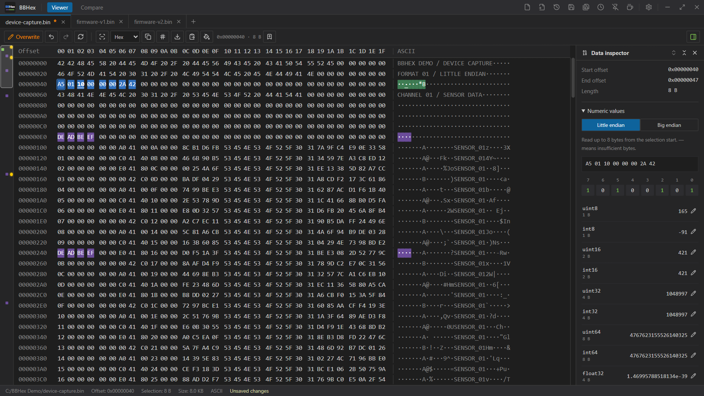
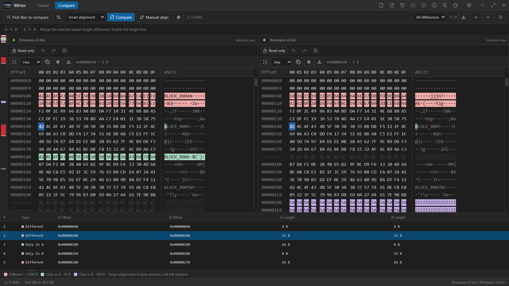
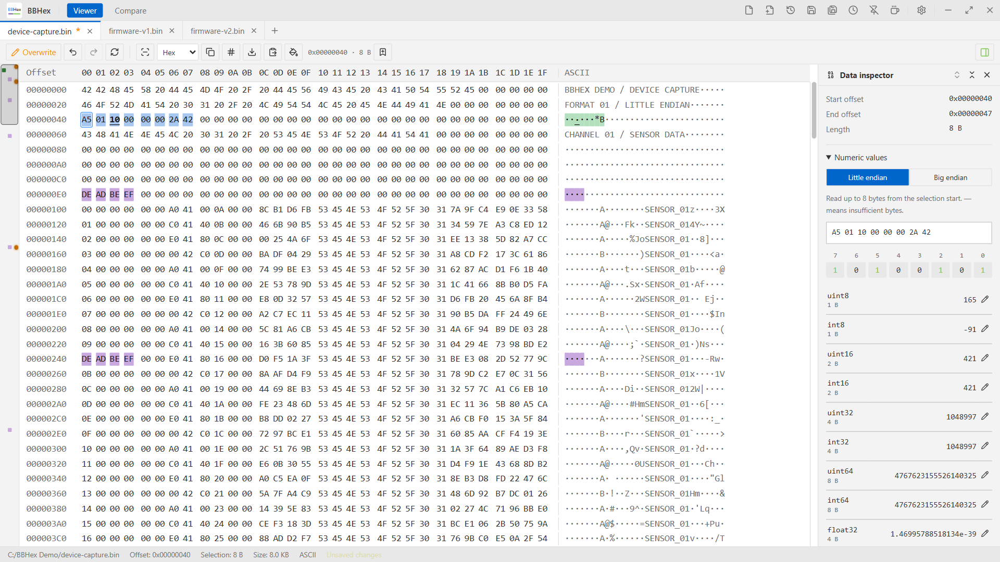
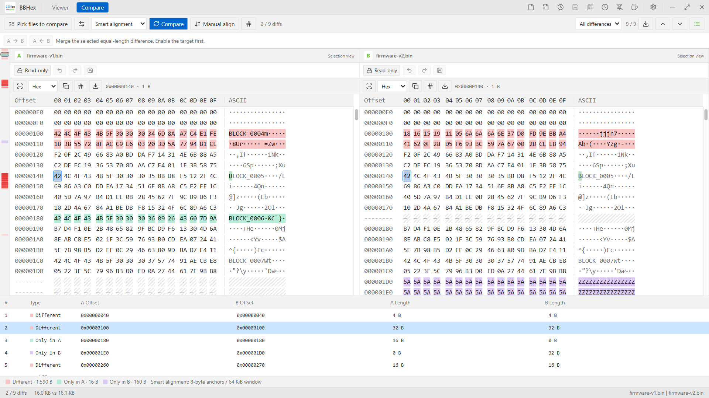

  <picture>
    <source media="(prefers-color-scheme: dark)" srcset="assets/brand/logo-dark.svg">
    <source media="(prefers-color-scheme: light)" srcset="assets/brand/logo-light.svg">
    
  </picture>

<h1 align="center">BBHex</h1>

<strong>See the bytes. Understand the data. Compare with confidence.</strong>

A Windows binary file viewer, editor and comparator by BBCom Team.

  English · <a href="README.zh-CN.md">简体中文</a> 
  <a href="https://github.com/BBComTeam/BBHex/releases">Releases &amp; downloads</a> ·
  <a href="https://www.bbcom.online/">Website</a> ·
  <a href="https://github.com/BBComTeam/BBHex/issues">Feedback</a>

BBHex combines HEX/ASCII viewing, precise byte editing and side-by-side comparison in one desktop workspace. Explore firmware images, inspect device captures and review changes between binary versions, with a familiar interface inspired by [BBCom](https://github.com/BBComTeam/BBCom).

> **About this repository:** This is the public home for BBHex documentation, screenshots, issue reports and release installers. The application source code is not published here. A public repository does not make the application open source.

## Features

### Binary viewing and navigation

- **Linked HEX and ASCII views** with multiple file tabs, byte grouping and adjustable font size.
- **File overview** with a viewport indicator, search-hit distribution, edited-byte markers and bookmark dots. Click to navigate without changing your selection.
- **Precise navigation** by offset, range selection, page controls and address hints while dragging the overview or scrollbar.
- **HEX and ASCII search**, including whole-byte `??` wildcards and selection-scoped searches. Search opens in the mode of the selected HEX or ASCII pane.

### Comparison

- **Side-by-side comparison** with separate colors for changed bytes, A-only data and B-only data.
- **Strict comparison, smart alignment and manual alignment**, with aligned gaps for inserted or missing data.
- **Difference list and navigation**, type filters and CSV report export.
- **Sync Selection**: select data in either file and inspect the corresponding selection on both sides.
- **Independent data inspectors** for A and B. Each can be collapsed when you need more room.
- Search, address navigation and bookmarks work in Compare too, with clear A/B context.
- Copy selected equal-length difference blocks between files after enabling editing in the destination.

### Data inspection and editing

- **Data Inspector** for signed/unsigned integers, floating-point values and individual bits, with little-endian and big-endian interpretation.
- **Overwrite editing** in HEX, ASCII or numeric form; click a bit to toggle it and update the byte view.
- Create a file with a chosen size and fill byte, fill a range, or replace a search match with equal-length data.
- Undo/redo, HEX/ASCII/C-array copying and raw binary range export.
- Named range bookmarks and **CRC32, SHA-256, SUM8, SUM16 and XOR8** selection checksums.

### ARM Cortex-M instruction decoding

Enable **Instruction Decoder** inside Data Inspector in Viewer or Compare, choose a processor profile and select an instruction's bytes.

- **Thumb / Thumb-2** decoding with Cortex-M4F and Cortex-M33 profiles, plus a limited Cortex-M55 preview.
- Decode the first instruction at the selected position, with halfword alignment and 16-/32-bit instruction lengths.
- Configure the file offset and image load address to map file positions to memory addresses.
- Inspect immediate values, branch targets and PC-relative operands. When a literal maps into the file, read its static value in **hexadecimal and decimal**.

This is single-instruction static analysis, not CPU emulation. Runtime registers and prior instruction context are not reconstructed. Alignment alone cannot establish an instruction boundary. The M55 preview does **not** support Helium/MVE or Armv8.1-M-specific instructions.

### Your workspace

- **Dark and light themes**, English and Simplified Chinese interfaces, and theme-specific highlight colors.
- Customize selection, search, bookmark and comparison colors.
- Automatically retained preferences, plus **Save / Load configuration**.
- Recent files and optional restoration of saved-file sessions.
- Windows File Explorer integration for opening files and selecting Compare A/B. Register or remove the current user's entries from Settings.

## Screenshots

### Dark and light themes

| Viewer · Dark | Compare · Dark |
| :---: | :---: |
|  |  |

| Viewer · Light | Compare · Light |
| :---: | :---: |
|  |  |

### A closer look

| Sync Selection + Data Inspector | ARM instruction decoding |
| :---: | :---: |
|  |  |

Click an image for full resolution. The feature close-ups use the Chinese interface. All images use synthetic demo data; the gallery spans different application revisions. See [image notes](assets/README.md).

## Installation

### GitHub Releases

Visit **[Releases & downloads](https://github.com/BBComTeam/BBHex/releases)** for published installers and release notes. Installers will be listed there as releases are published; an empty Releases page means a GitHub download has not been published yet.

BBHex targets Windows x64. Depending on the release, the available assets may include:

| Package | Purpose |
| --- | --- |
| `.exe` setup | Interactive installer with an English / Simplified Chinese language choice |
| `en-US.msi` | English Windows Installer package |
| `zh-CN.msi` | Simplified Chinese Windows Installer package |

Choose one installer, then select your preferred application language in Settings. Check the individual release notes for requirements and the packages actually provided. The app uses Microsoft Edge WebView2; follow any runtime setup instructions in the installer or release notes.

## Quick start

1. **Open** a file with `Ctrl+O`, or **create** one with `Ctrl+N`.
2. Select bytes in HEX or ASCII and read the Data Inspector. Search with `Ctrl+F` or jump to an offset with `Ctrl+G`.
3. To edit, switch from **Read-only** to **Overwrite**. Save with `Ctrl+S` or use `Ctrl+Shift+S` to save a copy.
4. In **Compare**, choose files A and B and start the comparison. Use `F8` / `Shift+F8` to move through differences.
5. Enable **Sync Selection** to compare fields through both inspectors. Enable **Instruction Decoder** when inspecting Cortex-M instructions.

Existing files open read-only by default. Overwrite editing preserves file length; replacements and comparison merges use equal-length ranges. Session restoration reopens saved files from disk and does not recover unsaved edits or undo history.

## Configuration

Use the left configuration sidebar to choose theme, language, font size, byte layout and highlight colors. Preferences are retained automatically without an explicit save. **Save** exports your persistent configuration; **Load** restores it later or on another installation. Configuration files do not replace backups of the binary files you edit.

## Keyboard shortcuts

| Shortcut | Action |
| --- | --- |
| `Ctrl+N` / `Ctrl+O` | Create / open a file |
| `Ctrl+S` / `Ctrl+Shift+S` | Save / Save As in Viewer |
| `Ctrl+F` / `Ctrl+G` | Search / go to offset in Viewer or Compare |
| `Ctrl+Z` / `Ctrl+Y` | Undo / redo in Viewer |
| `Ctrl+B` | Add or rename a bookmark for the current selection |
| `F2` / `Shift+F2` | Next / previous bookmark |
| `F3` / `Shift+F3` | Next / previous search result |
| `F7` | Start or cancel manual alignment in Compare |
| `F8` / `Shift+F8` | Next / previous filtered difference |
| `Ctrl+Mouse wheel` | Adjust byte-grid font size |

In Compare, search, go-to and bookmark commands apply to the last active file. A and B keep separate searches and bookmarks.

## Feedback

Found an issue or have an idea? [Open an issue](https://github.com/BBComTeam/BBHex/issues). Include the BBHex version, Windows version, reproduction steps, expected and actual behavior, and a screenshot or small non-sensitive sample if useful. English and Chinese reports are welcome.

## Related tool: BBCom

Working with serial devices and communication logs? Try **BBCom**, another tool by BBCom Team: [GitHub](https://github.com/BBComTeam/BBCom) · [Microsoft Store](https://apps.microsoft.com/detail/9nd3d780wc1w).

## Acknowledgments

BBHex uses Tauri, React, Lucide icons and the Capstone disassembly engine. Third-party components retain their respective licenses; the application provides third-party notices in **About → Third-party licenses**. This repository does not grant an open-source license to BBHex application code.

---

**BBCom Team © 2026** · [www.bbcom.online](https://www.bbcom.online/)
